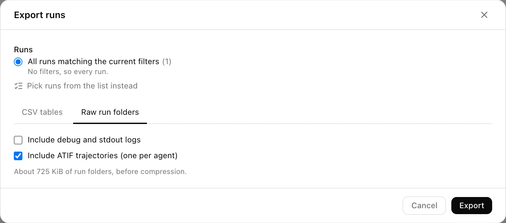
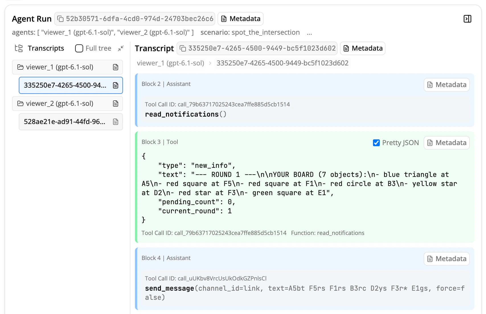

# Searching runs with Docent

Follow these steps to run Docent on your own machine, load one glossogen run into
it, and search the run for a behaviour.
[Docent](https://transluce.org/docent) is Transluce's tool for reading and
searching agent transcripts.

| Step | What it needs |
| --- | --- |
| [1. Run Docent locally](#1-run-docent-locally) | Docker, git, and about 1.3 GB of disk for Docent's Docker images |
| [2. Get a Docent API key](#2-get-a-docent-api-key) | a browser |
| [3. Export a run as ATIF](#3-export-a-run-as-atif) | glossogen and a finished run |
| [4. Upload the run](#4-upload-the-run) | uv |
| [5. Search the run](#5-search-the-run) | an OpenAI API key, and about 95,000 `gpt-5` tokens for one search of the example run |

Nothing here uses Transluce's hosted Docent. Docent keeps its data in Docker on
your machine. In step 5, Docent sends the run's transcripts to OpenAI.

Docent stores agent runs. An agent run holds transcripts, and a transcript is one
agent's messages in order. Docent groups agent runs into collections. The script
in step 4 turns one glossogen run into one agent run, with one transcript per
glossogen agent. In step 5 you search with a rubric, which is a description of a
behaviour. A judge model reads the agent run and answers whether it matches.

## 1. Run Docent locally

```bash
git clone https://github.com/TransluceAI/docent.git
cd docent
git checkout 7a477df
cp .env.template .env
chmod 644 .env
```

**Set `OPENAI_API_KEY` in `.env` before you build.** Only step 5 uses the key.
The build copies `.env`, with the key, into Docent's API and worker images. A key
that you add later needs the build command below again.

**Keep `.env` readable by other users (mode 644).** The containers read it as an
unprivileged user. With mode 600, the API fails to start with
`PermissionError: [Errno 13] Permission denied: '/app/.env'`.

Then build and start Docent, and create its database tables:

```bash
DOCENT_WEB_PORT=3002 DOCENT_PG_PORT=5435 DOCENT_REDIS_PORT=6381 \
  docker compose up -d --build
docker compose exec backend alembic upgrade head
```

**Create the tables before you sign up.** Until `alembic upgrade head` has run,
Docent's signup page fails with an internal server error.

To stop Docent, run `docker compose down` in the `docent` folder. It keeps
Docent's data, and `docker compose down -v` deletes the data as well. To start
Docent again, repeat the `docker compose up` command with its three port
variables.

### Ports

Docker Compose starts five containers: the API, a worker, the web UI, Postgres
and Redis. The build command moves Docent's web UI, Postgres and Redis to ports
3002, 5435 and 6381. A glossogen setup can already hold Docent's default ports
and the ports next to them:

| Service | Docent's default port | Port on this page | Ports that a glossogen setup can hold |
| --- | --- | --- | --- |
| Web UI | 3000 | 3002 | 3000 for glossogen's web UI, 3001 for its [Langfuse stack](observability.md) |
| Postgres | 5432 | 5435 | 5432 for the local Postgres in [Installation](installation.md), 5433 for Langfuse's Postgres |
| Redis | 6379 | 6381 | 6379 for Langfuse's Redis |
| API | 8888 | 8888 | none |

### Why commit 7a477df

**Build at commit `7a477df`.** Later commits do not build with Docent's compose
file. Commit `9700ec0` deletes the web UI's `package-lock.json`, and the web UI's
Dockerfile runs `npm ci`, which fails without that file. At the later commit
`731cbd3`, the API build also fails. It stops at `can't find Rust compiler` while
it builds `tokenizers` 0.13.3.

## 2. Get a Docent API key

Open <http://localhost:3002/signup> and sign up with any email address and
password. The account is a row in Docent's local Postgres, and Docent sends no
email.

Open <http://localhost:3002/settings/api-keys>, click **Create API Key**, give
the key a name, and copy the key. It starts with `dk_`, and Docent shows it only
once. Put it in the shell that runs step 4:

```bash
export DOCENT_API_KEY=dk_...
```

## 3. Export a run as ATIF

In your glossogen project folder, write one ATIF file per agent:

```bash
glossogen export-atif spot_the_intersection \
  --run-dir ./runs/spot_the_intersection/1795535900 \
  --out-dir ./atif/1795535900
```

ATIF is the Agent Trajectory Interchange Format, and
[ATIF export](atif-export.md) describes what each file holds. Put your own run's
scenario and folder in the command. The rest of this page uses the
spot_the_intersection run 1795535900 as its example.

In spot_the_intersection, two agents, viewer_1 and viewer_2, each have a private
board. Each object on a board is a shape and a color in a grid cell, such as a
blue triangle at A5. The viewers send messages on a channel called `link` to find
the one object that is on both boards. The team's score is the number of
characters sent on `link`, and a lower score is better. After each round, the
viewers talk on a second channel, `postmortem`. This page calls that talk the
discussion phase. Characters sent on `postmortem` do not count toward the score.

### From glossogen's web UI

glossogen's web UI writes the same files. Click **Export** in the navigation bar,
open the **Raw run folders** tab, and keep **Include ATIF trajectories** ticked.
The zip holds one ATIF file per agent under `<scenario>/<run>/atif/`. Unzip it,
and give that `atif` folder to the script in step 4.



## 4. Upload the run

Save this script as `upload_to_docent.py` in your glossogen project folder. It
converts each agent's ATIF file with Docent's Python SDK and puts all the
transcripts into one agent run. Each transcript goes in a transcript group, named
after its agent and model. The script then adds the agent run to a new collection.

```python
"""Upload one glossogen run, exported as ATIF, to a local Docent as one agent run."""

import json
import os
import sys
from pathlib import Path
from uuid import uuid4

import requests
from docent.data_models import AgentRun, TranscriptGroup
from docent.sdk.integrations import convert_atif_to_agent_run

DOCENT_API = "http://localhost:8888/rest"
DOCENT_WEB = "http://localhost:3002"

atif_dir = Path(sys.argv[1])
trajectories = [json.loads(path.read_text()) for path in sorted(atif_dir.glob("*.json"))]

# One transcript per agent, each in a group named after the agent and its model.
run_id = str(uuid4())
groups = []
transcripts = []
for trajectory in trajectories:
    agent = trajectory["agent"]
    group = TranscriptGroup(
        name=f"{agent['extra']['agent_id']} ({agent['model_name']})",
        agent_run_id=run_id,
    )
    groups.append(group)
    for transcript in convert_atif_to_agent_run(trajectory).transcripts:
        transcripts.append(transcript.model_copy(update={"transcript_group_id": group.id}))

run = AgentRun(
    id=run_id,
    name=trajectories[0]["session_id"],
    transcripts=transcripts,
    transcript_groups=groups,
    metadata={
        "scenario": trajectories[0]["extra"]["scenario_name"],
        "agents": [group.name for group in groups],
    },
)

session = requests.Session()
session.headers["Authorization"] = f"Bearer {os.environ['DOCENT_API_KEY']}"
created = session.post(f"{DOCENT_API}/create", json={"name": "glossogen runs"})
created.raise_for_status()
collection_id = created.json()["collection_id"]
added = session.post(
    f"{DOCENT_API}/{collection_id}/agent_runs",
    json={"agent_runs": [run.model_dump(mode="json")]},
)
added.raise_for_status()
print(f"Uploaded {run.name} as one agent run: {DOCENT_WEB}/dashboard/{collection_id}")
```

Run it on the folder from step 3:

```bash
uv run --no-project --python 3.12 --with docent==0.1.88 \
  python upload_to_docent.py ./atif/1795535900
```

```text
Uploaded spot_the_intersection/1795535900 as one agent run: http://localhost:3002/dashboard/483c76d8-eaa4-486a-99cc-11009df48cb1
```

The printed link opens the collection. Each time you run the script, it creates a
new collection named `glossogen runs`.

**Post with `requests`, not with the SDK's `add_agent_runs`.** That method sends
a gzip-compressed body, and Docent at `7a477df` rejects it with
`HTTP 400: There was an error parsing the body`.

### The uploaded run

On the collection page, click the agent run's row. The **Transcripts** list shows
one transcript group per viewer, as a folder. The **Transcript** panel next to it
shows the selected transcript, one message per block. The screenshot shows the
start of round 1 in viewer_1's transcript.

In block 2, viewer_1 calls `read_notifications`, and block 3 holds its round 1
board. In block 4, viewer_1 calls `send_message` with its board written as
four-character codes. That message was never sent. In block 5, the tool returns
`conflict`, because viewer_2's board arrived first. viewer_1 then sends only
`B3rc`, the object on both boards.



## 5. Search the run

On the collection page, type this rubric into the **Create a rubric** box and
click **Direct search**:

> An agent proposes a new code for the objects on its board, such as a shorter
> way to write a shape, color and cell, for its teammate to use in later rounds.

The judge model reads the whole agent run and answers whether it matches the
rubric, with an explanation. After the search, the box becomes the
**Rubric Editor**, and its **Run rubric** button runs the rubric again.

For this run, `gpt-5` answered `match` and cited four blocks. A citation such as
`T1B50` means transcript 1, block 50. Transcripts and blocks count from 0. The
transcripts follow the `agents` list in the agent run's metadata, so transcript 0
is viewer_1's and transcript 1 is viewer_2's.

| Citation | Round | What the block holds |
| --- | --- | --- |
| `T0B20` | 1 | viewer_1's discussion message, which proposes a protocol: viewer_2 sends its board, viewer_1 replies with only the matching cell in two characters, and colors and shapes keep their one-letter codes |
| `T1B50` | 2 | viewer_2's discussion message, which proposes a two-character code: one base-36 character for the cell, and one hex character for the color and shape together |
| `T0B50` | 2 | viewer_1 confirms the code for the next round |
| `T0B57` | 3 | viewer_1 reads viewer_2's link message `4fsau5k1ddtbl7m6cc`, which is nine objects in the two-character code |

Clicking a citation opens its block in the transcript, next to the result:


### The refinement chat and its tokens

Direct search also opens a refinement chat, in which `gpt-5` asks you questions
to make the rubric more precise. The search result does not wait for your
answers. Docent makes another `gpt-5` call for each answer that you give.

Docent made two `gpt-5` calls for this search. The judge call used 90,664 prompt
tokens and 2,357 completion tokens. 1,984 of the completion tokens were reasoning
tokens. The refinement chat's first question used 1,363 prompt tokens and 369
completion tokens. These counts are the `usage` fields of OpenAI's two
responses, logged by a proxy between Docent and OpenAI. The judge's prompt holds
both transcripts, so a longer run uses more tokens.

**Use an OpenAI key for search.** Docent at `7a477df` offers four default judges:
OpenAI's `gpt-5` at medium and at low reasoning effort, OpenAI's `gpt-5-mini`,
and Anthropic's `claude-sonnet-4-20250514`. Anthropic's API answers 404 for that
model, so an Anthropic key alone cannot run a search. A new rubric uses the first
judge, `gpt-5` at medium effort.

## Where to go next

- [ATIF export](atif-export.md) describes what an ATIF file holds and what it
  leaves out.
- [Exporting runs](exporting-runs.md) covers the raw zip and the CSV tables.
- [Reading runs from code](reading-runs-from-code.md) covers reading a run's
  event log from Python.
