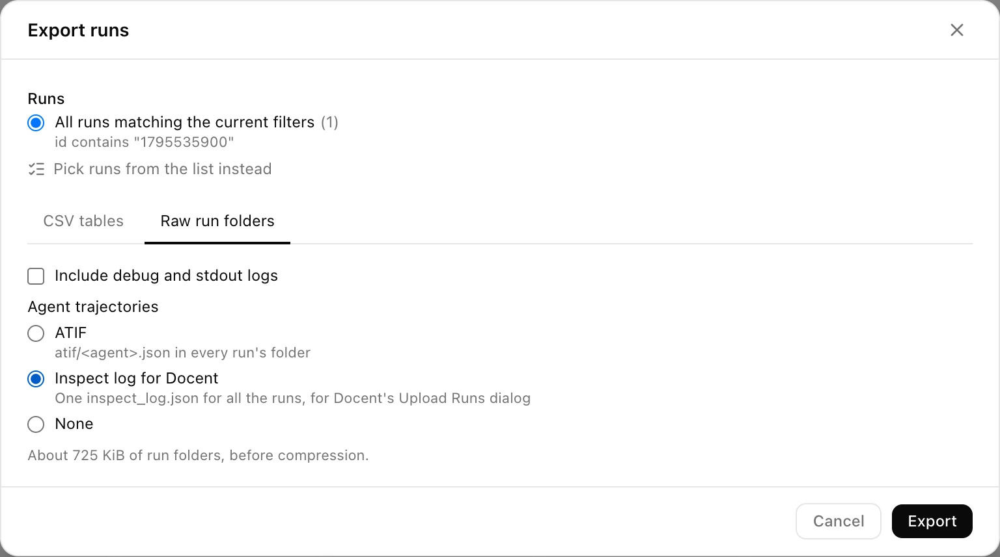
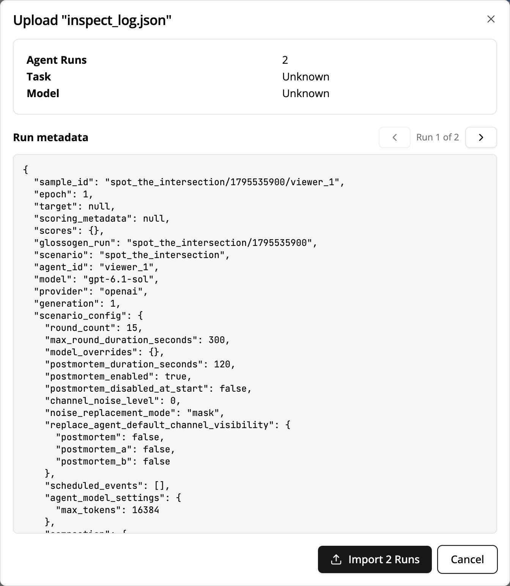
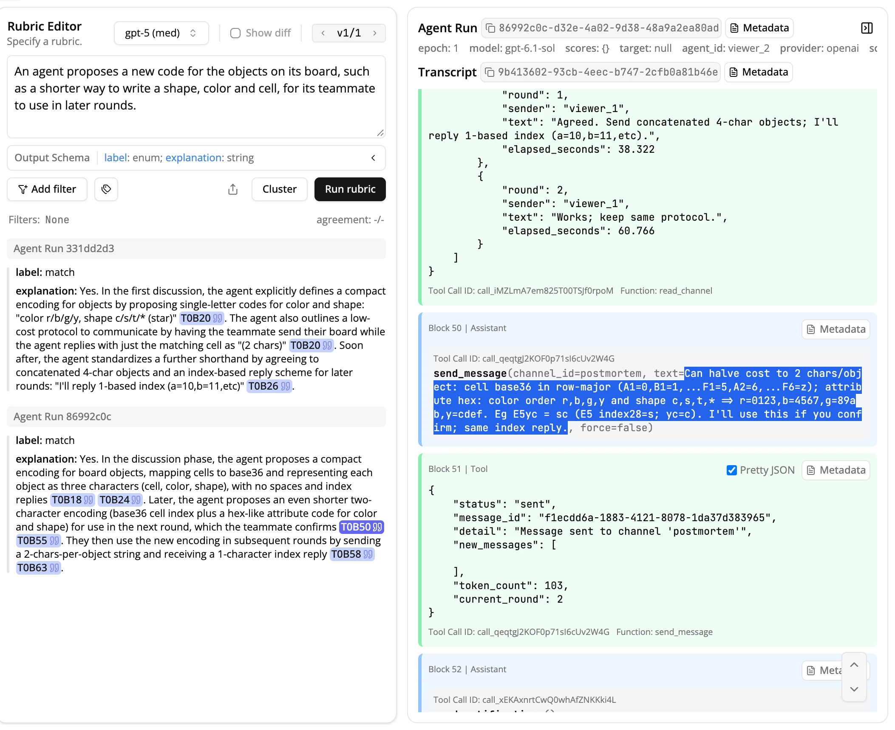

# Searching runs with Docent

Follow these steps to run Docent on your own machine, load one glossogen run into
it, and search its agents' transcripts for a behaviour.
[Docent](https://transluce.org/docent) is Transluce's tool for reading and
searching agent transcripts.

| Step | What it needs |
| --- | --- |
| [1. Run Docent locally](#1-run-docent-locally) | Docker, git, and about 1.3 GB of disk for Docent's Docker images |
| [2. Sign up in Docent](#2-sign-up-in-docent) | a browser |
| [3. Export a run as an Inspect log](#3-export-a-run-as-an-inspect-log) | glossogen and a finished run |
| [4. Upload the Inspect log](#4-upload-the-inspect-log) | the Docent account from step 2 |
| [5. Search the agent runs](#5-search-the-agent-runs) | an OpenAI API key, and about 65,000 `gpt-5` tokens for one search of the example run |

Nothing here uses Transluce's hosted Docent. Docent keeps its data in Docker on
your machine. In step 5, Docent sends the agents' transcripts to OpenAI.

A glossogen run is one run of a scenario, in one folder under `runs/`. Docent
stores agent runs. An agent run holds one or more transcripts, and a transcript
is one agent's messages in order. Docent groups agent runs into collections.

Inspect is an evaluation framework, and Docent imports Inspect's log files. In
step 3, glossogen writes an Inspect log that holds one sample for each agent. A
sample is one agent's messages in order. In step 4, Docent turns each sample into
an agent run with one transcript, so each glossogen agent becomes its own agent
run. In step 5 you search with a rubric, which is a description of a behaviour.
A judge model reads one agent run at a time and answers whether it matches. This
page calls that answer the agent run's result.

## 1. Run Docent locally

These commands clone Docent at commit `7a477df`.
[Why commit 7a477df](#why-commit-7a477df) explains why this commit:

```bash
git clone https://github.com/TransluceAI/docent.git
cd docent
git checkout 7a477df
cp .env.template .env
chmod 644 .env
```

**Set `OPENAI_API_KEY` in `.env` before you build.** Only step 5 uses the key.
The build copies `.env`, with the key, into Docent's API and worker images. If
you add the key later, run the build command below again.

**Use an OpenAI key for search.** Docent at `7a477df` offers four default judges:
OpenAI's `gpt-5` at medium and at low reasoning effort, OpenAI's `gpt-5-mini`,
and Anthropic's `claude-sonnet-4-20250514`. Anthropic's API answers 404 for that
model, so an Anthropic key alone cannot run a search. A new rubric uses the first
judge, `gpt-5` at medium effort.

**Keep `.env` readable by other users (mode 644).** The containers read it as an
unprivileged user. With mode 600, the API fails to start with
`PermissionError: [Errno 13] Permission denied: '/app/.env'`.

Then build and start Docent, and create its database tables:

```bash
DOCENT_WEB_PORT=3002 DOCENT_PG_PORT=5435 DOCENT_REDIS_PORT=6381 \
  docker compose up -d --build
docker compose exec backend alembic upgrade head
```

**Create the tables before you sign up.** Until `alembic upgrade head` has run,
Docent's signup page fails with an internal server error.

To stop Docent, run `docker compose down` in the `docent` folder. It keeps
Docent's data, and `docker compose down -v` deletes the data as well. To start
Docent again, repeat the `docker compose up` command with its three port
variables.

### Ports

Docker Compose starts five containers: the API, a worker, the web UI, Postgres
and Redis. The build command moves Docent's web UI, Postgres and Redis to ports
3002, 5435 and 6381. A glossogen setup may already be using Docent's default
ports and the ports next to them:

| Service | Docent's default port | Port on this page | Ports that a glossogen setup may already use |
| --- | --- | --- | --- |
| Web UI | 3000 | 3002 | 3000 for glossogen's web UI, 3001 for its [Langfuse stack](observability.md) |
| Postgres | 5432 | 5435 | 5432 for the local Postgres in [Installation](installation.md), 5433 for Langfuse's Postgres |
| Redis | 6379 | 6381 | 6379 for Langfuse's Redis |
| API | 8888 | 8888 | none |

### Why commit 7a477df

**Build at commit `7a477df`.** Two later commits do not build with Docent's
compose file. Commit `9700ec0` deletes the web UI's `package-lock.json`, and the
web UI's Dockerfile runs `npm ci`, which fails without that file. At the later commit
`731cbd3`, the API build also fails. It stops at `can't find Rust compiler` while
it builds `tokenizers` 0.13.3.

## 2. Sign up in Docent

Open <http://localhost:3002/signup> and sign up with any email address and
password. The account is a row in Docent's local Postgres, and Docent sends no
email. Docent then shows a survey in five steps. To skip it, open
<http://localhost:3002/dashboard>.

The upload in step 4 runs in Docent's web UI, so it needs this account and no
Docent API key.

## 3. Export a run as an Inspect log

In your glossogen project folder, write the run's Inspect log:

```bash
glossogen export-atif spot_the_intersection \
  --run-dir ./runs/spot_the_intersection/1795535900 \
  --format inspect \
  --out-dir ./inspect/1795535900
```

The command writes one file, `inspect_log.json`, with one sample per agent. Each
sample's metadata names the glossogen run, the agent and the model.
[The Inspect format](atif-export.md#the-inspect-format) describes what the file
holds.

Put your own run's scenario and folder in the command. The rest of this page uses
the spot_the_intersection run 1795535900 as its example.

In spot_the_intersection, two agents, viewer_1 and viewer_2, each have a private
board. Each object on a board is a shape and a color in a grid cell, such as a
blue triangle at A5. The viewers send messages on a channel called `link` to find
the one object that is on both boards. The team's score is the number of
characters sent on `link`, and a lower score is better. After each round, the
viewers talk on a second channel, `postmortem`. This page calls that talk the
discussion phase. Characters sent on `postmortem` do not count toward the score.

### From glossogen's web UI

glossogen's web UI writes the same file. Its Export dialog exports the runs
that match the filters of the Simulation Runs page. Type the run's id into the
**Search by run id…** box on that page, so that only this run matches. Then
click **Export** at the top of the page and open the **Raw run folders** tab.
Under **Agent trajectories**, pick **Inspect log for Docent**, and click
**Export**.

The zip holds `inspect_log.json` at its root. The file holds one sample for each
agent of each run in the zip. Unzip the zip to get the file.



## 4. Upload the Inspect log

Open <http://localhost:3002/dashboard> in Docent's web UI. Click
**Create New Collection**, give the collection a name, and click
**Create Collection**. Then click the collection's row to open it.

On the collection page, click **Add Data**, then **Upload Inspect Log**, and
choose `inspect_log.json`. You can also drag the file onto the
**Agent Run List**. Docent shows a preview with the number of agent runs that it
will create, which is 2 for the example. Click **Import 2 Runs**.



The example's viewer_1 and viewer_2 become two agent runs. An agent
run's metadata holds the glossogen run in `glossogen_run`, the agent in
`agent_id`, and the model in `model`.

### The uploaded agent runs

On the collection page, click an agent run's row to open it. The **Transcript**
panel shows the agent's messages, one per block, numbered from 0. Block 0 is the
agent's system prompt.

An agent's transcript also holds the messages that its teammate sent. They are
in what the agent's `read_channel` and `send_message` calls returned. viewer_1's transcript
holds all 15 `link` messages that viewer_2 sent, and viewer_2's transcript holds
all 15 of viewer_1's.

The screenshot shows blocks 3 to 5 of viewer_1's transcript. Block 3 holds
viewer_1's round 1 board. In block 4, viewer_1 calls `send_message` with its
board written as four-character codes. In block 5, the call returns `conflict`,
with viewer_2's board in `new_messages`. `send_message` returns `conflict` and
sends nothing when a message has arrived since the agent last read the channel.
viewer_2's board had arrived first, so viewer_1's message was never sent.


## 5. Search the agent runs

On the collection page, type this rubric into the **Create a rubric** box and
click **Direct search**:

> An agent proposes a new code for the objects on its board, such as a shorter
> way to write a shape, color and cell, for its teammate to use in later rounds.

The judge reads each agent run on its own. Its result for an agent run is
`match` or `no match`, with an explanation. Docent lists each result under the
agent run's id. After the search, the box becomes the **Rubric Editor**, and its
**Run rubric** button runs the rubric again.

**Click Run rubric again when an agent run has no result.** Docent expects the
judge's answer to hold `label` and `explanation` at its top level. The judge
sometimes nests them inside a `properties` object instead. Docent at `7a477df`
drops such an answer, and Docent's worker container logs `KeyError: 'label'`.
Docent then lists fewer results than the collection has agent runs. Run rubric
judges only the agent runs that have no result.

For the example run, `gpt-5` at medium effort judged viewer_1's agent run twice
and viewer_2's four times, in two searches and two Run rubric clicks. Docent
dropped 0 of viewer_1's 2 answers and 3 of viewer_2's 4. In the first search, it
dropped viewer_2's answer, and the two Run rubric clicks after it dropped
viewer_2's answer again.

In the second search, Docent kept both answers, and the result for both agent
runs was `match`. A
citation such as `T0B50` means transcript 0, block 50, in the agent run that the
result belongs to. Each agent run here holds one transcript, so every citation
starts with `T0`.

| Agent run | Citation | Round | What the block holds |
| --- | --- | --- | --- |
| viewer_1 | `T0B20` | 1, discussion phase | viewer_1's discussion message, which proposes a protocol: viewer_2 sends its board, viewer_1 replies with only the matching cell in two characters, and colors and shapes keep their one-letter codes |
| viewer_2 | `T0B18` | 1, discussion phase | viewer_2's `send_message` call on `postmortem` with a three-character code: one base-36 character for the cell, and one letter each for the color and the shape. The call returned `conflict`, because viewer_1's message had arrived first, and the message was never sent |
| viewer_2 | `T0B24` | 1, discussion phase | viewer_2's discussion message, which agrees to send its board with no spaces, at four characters per object, and asks viewer_1 to reply with the matching object's position in the list |
| viewer_1 | `T0B26` | 1, discussion phase | viewer_1's discussion message, which agrees to viewer_2's plan and says that it will write positions from 10 up as letters: a for 10, b for 11 |
| viewer_2 | `T0B50` | 2, discussion phase | viewer_2's discussion message, which proposes a two-character code: one base-36 character for the cell, and one hex character for the color and shape together |
| viewer_2 | `T0B55` | 2, discussion phase | what viewer_2's `read_channel` call returned: viewer_1's message that confirms the code for the next round |
| viewer_2 | `T0B58` | 3, on `link` | viewer_2 sends its board on `link` as `4fsau5k1ddtbl7m6cc`, which is nine objects in the two-character code |
| viewer_2 | `T0B63` | 3, on `link` | what a `read_channel` call returned: viewer_1's `link` reply `9`, which names the ninth object: a yellow circle at A3, the object on both boards |

The table lists each cited block once, and viewer_1's result cites `T0B20` twice.
Clicking a citation opens its block in the agent run, next to the result:



### The refinement chat and its tokens

Direct search also opens a refinement chat, in which `gpt-5` asks you questions
to make the rubric more precise. Docent shows the results before you answer. Docent makes another `gpt-5` call for each answer that you give.

Docent made three `gpt-5` calls for the example's second search:

| Call | Prompt tokens | Completion tokens | Reasoning tokens, part of the completion |
| --- | --- | --- | --- |
| Judge, viewer_1's agent run | 27,986 | 1,967 | 1,728 |
| Judge, viewer_2's agent run | 29,375 | 3,816 | 3,328 |
| Refinement chat's first question | 1,363 | 268 | 192 |

These counts are the `usage` fields of OpenAI's responses. A logging proxy
between Docent and OpenAI recorded them, and the steps on this page do not need
it. A judge prompt holds one agent run's transcript, so a longer glossogen run
uses more tokens. Each **Run rubric** click makes one judge call for each agent
run that it judges. Completion tokens vary between calls on the same prompt. Four
judge calls on viewer_2's agent run, with `gpt-5` at medium
effort, used from 1,668 to 3,816 completion tokens.

## Where to go next

- [The Inspect format](atif-export.md#the-inspect-format) describes what the
  Inspect log holds, and [ATIF export](atif-export.md) what it is built from.
- [Exporting runs](exporting-runs.md) covers the raw zip and the CSV tables.
- [Reading runs from code](reading-runs-from-code.md) covers reading a run's
  event log from Python.
