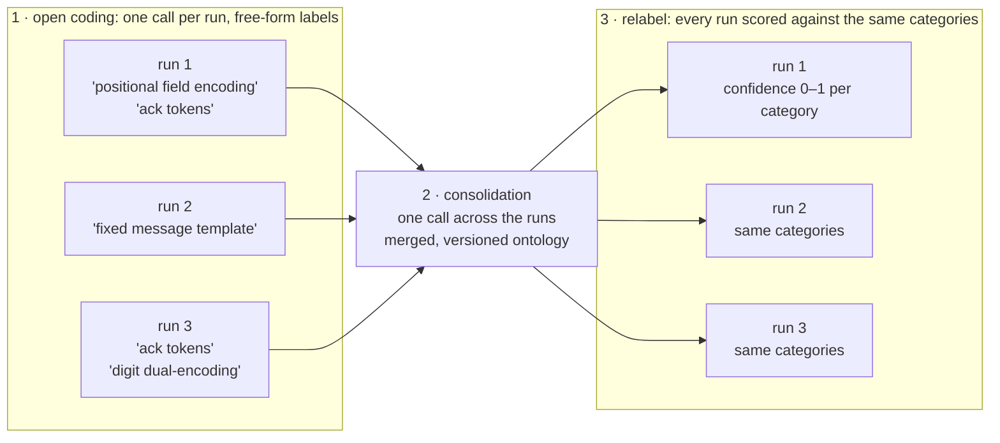

# Evaluation

Evaluation scores a finished run. Deterministic algorithms and LLM judges are
requested the same way and land in the same report.

```bash
glossogen evaluate veyru \
  --run-dir ./runs/veyru/1742234567 \
  --metrics round_success,mean_chars_per_round,shorthand_codes \
  --model claude-haiku-4-5-20251001 --provider anthropic
```

From a checkout, spell each command
`VIRTUAL_ENV= uv run --no-sync python -m glossogen ...`.

`--model` / `--provider` select the LLM judge. Deterministic metrics make no judge
calls, but the judge is built on every invocation, so its provider's API key has to
be set either way.
Scenario configuration is read from the run's JSONL, so no scenario flags are
needed.

**Only evaluate a run that has emitted `simulation_ended`.** That event is the
one reliable "finished" signal. A round-count gate fires early, because
`round_advanced` to round N means round N *started*, and its result is not
recorded until it ends. Evaluating then silently drops the final round.

| Flag | Does |
|---|---|
| `--run-dir` | The run directory to score, required |
| `--metrics` | Comma-separated metric names, required |
| `--model`, `--provider` | The LLM judge, required |
| `--probe-replicas N` | Replicas per (agent, question); required with `protocol_probe` |
| `--probe-round R` | Exclusive round cutoff for `protocol_probe` |
| `--ontology-path` | Pin `communication_feature_presence` to one ontology JSON |
| `--knobs` | A preset name or JSON file of knob overrides, merged onto the run's recorded config before validation |
| `--judge-settings` | The judge's model settings as JSON, e.g. `'{"max_tokens": 65536, "thinking": "low"}'` |
| `--inference-provider` | HuggingFace inference backend; refused with any other `--provider` |

**Keep the judge fixed across runs you intend to compare.** Judge-side noise then
stays constant and a difference between runs reflects agent behaviour rather than
judge variance.

`--knobs` covers a run whose scenario gained a required knob after the run was
created. Without it, validation rejects the recorded config and the run cannot be
scored.

## What a report contains

Each metric returns zero or more `Measurement` entries, written to
`<scenario>_report.json` under `measurements`:

- `metric_name` — the metric's name (`perplexity`), or a name it emits per team
  (`perplexity_team_a`) or per count (`dialog_retransmission` writes `dialog_count`)
- `score` — the headline scalar: a mean, fraction or count, depending on the metric
- `score_unit` — a short label saying what `score` is
- `summary` — one-line human-readable rollup
- `per_round[]` — `RoundObservation` entries (`round_number`, `value`, `note`)
- `per_agent[]` — `AgentObservation` entries, for metrics with a per-agent view

Some metrics also write a sidecar file next to the report: per-message repetition
factors, probe responses, similarity matrices, feature-presence vectors. Those are
listed under [Run Storage](../Architecture.md#run-storage).

`evaluation_cost` accumulates across invocations. When the judge's model, provider
and `--judge-settings` all match the report's, the new token usage is added to
`evaluation_cost.usage` and `estimated_cost_usd` is recomputed from the sum, so a
re-run that made no LLM calls leaves the total where it was. Any difference resets
the cost to the new invocation's, since a mid-stream judge change invalidates the
running total.

`evaluation_cost` counts judge calls only. `protocol_probe` and
`protocol_explanation` call each agent's own model, and their spend goes to
`protocol_probe_usage.json` and `protocol_explanation_usage.json`.

### When a metric produces nothing

A metric that cannot apply to a run returns no measurement and logs the skip at
`INFO`. Nothing is broken, so nothing fails, and no zero-score sentinel is written.

| Metric | Produces nothing when |
|---|---|
| The language and throughput metrics, `language_repetition` | the scenario has no primary channel |
| `language_strangeness`, `slang_emergence`, `neologism`, `shorthand_codes`, `dialog_retransmission` | the run has no messages on any channel |
| `communication_open_coding`, `communication_feature_presence` | the scenario builds no communication rounds |
| `round_success` | the scenario's `judge_round_result` recorded no verdicts |
| `round_success_after_resume` | the run is not a replace-agent, fork-at-round, cross-run or in-run-swap run, or recorded no verdicts |
| `protocol_probe` | the scenario provides no probe config |
| `protocol_learned_after_swap` | the scenario reports no boundary, or one side of it has no messages |
| `protocol_explanation` | no agent has a history to reconstruct |
| The probe similarity metrics | see [Protocol](#protocol) |

That is different from a metric that *cannot run*: a missing dependency or an error
the metric does not handle makes evaluation write the report and then exit non-zero.
See [optional extras](installation.md#optional-extras). The metrics that make many
judge or probe calls (`language_repetition`, `dialog_retransmission`,
`protocol_explanation`, `protocol_probe`) log a failed call and score the ones that
succeeded. When every call fails they produce nothing (`protocol_probe` a count of
zero), and the exit code still stays zero.

A few metrics do emit `score = 0`, because zero is a real observation there:
`round_ended_idle`, `round_ended_timeout` and `content_filter_refusal` all mean
"this run had none of those". `postmortem_ended_timeout` is a hybrid: `0` when a
postmortem ran and never timed out, nothing at all when the run had no postmortem.
A run recorded before `round_ended` events existed scores `0` on the two
`round_ended_*` metrics, with a summary saying the run predates the event.

**Re-running a metric replaces its earlier entry, even when it now produces
nothing or fails.** An entry under any other name, such as `round_success_team_a`
or `dialog_count`, is replaced only when the re-run emits that name again. Delete
the report to clear one that it no longer does. Metrics not named in `--metrics` keep their entries, so a
partial re-run leaves the rest of the report alone.

## Metrics

Every metric below is generic, available to any scenario that implements the
[hook it reads](creating-a-metric.md#scenario-hooks). A scenario can also ship
metrics for its own runs. Its README documents them, and
`GET /api/g/{group_slug}/scenarios` and the MCP `list_scenarios` tool list the
metrics each scenario offers.

### Communication style (LLM judge)

Each judge is scoped to one phenomenon so they do not overlap.

- `language_repetition` — how much a message redundantly re-encodes information
  (repeated tokens, digit+word dual-encoding, abbreviation+expansion), within the
  message only. Judges each round's pristine primary-channel messages as an
  enumerated list and returns one factor per message: 1.0 states each piece of
  information once, 2.0 roughly twice. Each round is judged 3 times and the factors
  averaged per message, so a run costs rounds × 3 calls. `per_round[].value` is the
  round's mean factor and `score` the mean over rounds. Writes the per-message
  factors to `language_repetition_messages.jsonl`, keyed by `message_id`. Judge
  output, so not bit-reproducible
- `language_strangeness` — unusual grammar, sentence structure, formatting,
  telegraph style
- `slang_emergence` — informal register shifts and colloquial expressions
- `neologism` — genuinely invented words with new meanings
- `shorthand_codes` — abbreviation systems and symbol-to-meaning mappings
- `dialog_retransmission` — per round, counts clarification/coordination messages
  and "please resend" requests. Judges the run 3 times and averages the counts.
  Writes two measurements, `dialog_count` and `retransmission_request_count`, each
  scoring the mean count per round

`language_strangeness`, `slang_emergence`, `neologism` and `shorthand_codes` each
make one judge call per run over every round's transcript. Their `score` is the
number of rounds where the judge found the phenomenon, and `per_round` lists those
rounds.

### Language and throughput (deterministic)

No LLM judge. Same input, same output. `perplexity` downloads `gpt2` on first use,
and the n-gram metrics download wikitext when their cache is cold: see
[optional extras](installation.md#optional-extras).

- `perplexity` — mean per-token surprisal of primary-channel messages under
  `gpt2`, in nats. Needs the `metrics-ml` extra
- `english_ngram_surprisal` — mean per-character surprisal under a character-level
  English trigram. Higher means less English-like
- `english_ngram_backoff_surprisal` — the same idea with stupid-backoff smoothing,
  keeping digits and punctuation in vocabulary
- `message_entropy` — Shannon entropy of a message's character distribution, in
  bits/char. Lower means more repetitive
- `gzip_compression_ratio` — per-message DEFLATE ratio. Lower means more
  compressible
- `mean_chars_per_round` — total characters per round on the primary channel,
  averaged across every run round; a silent round contributes zero
- `mean_chars_per_message` — character length averaged across messages. More
  messages add observations but do not directly increase the score

`perplexity`, the n-gram metrics, `message_entropy` and `gzip_compression_ratio`
score the **pristine** text the sender composed, resolved through the message id,
rather than what a noisy channel delivered. They describe the language the agents
intended. The two character counts measure what the channel carried. For what
each number means and how to read them together, see [Communication metrics](communication-metrics.md).

### Round outcome

- `round_success` — fraction of rounds judged a success by the scenario's
  `judge_round_result`. Multi-team scenarios emit one measurement per team
  (`round_success_team_a`, ...)
- `round_success_after_resume` — the same accounting over the post-swap window of
  a replace-agent, fork-at-round, cross-run or in-run-swap run. `summary` gives
  `Δ vs source: ±N pp` against the baseline described in
  [Scoring a swap](agent-swaps.md#scoring-a-swap), or says the source is not
  available
- `round_ended_idle` / `round_ended_timeout` — rounds whose main phase ended by
  every agent going idle, or by the wall clock, read from `round_ended` events. A
  round the scenario ends itself, its goal settled, counts in neither
- `postmortem_ended_timeout` — postmortem phases that hit the wall clock rather
  than going idle, listed in `per_round`. Reads `PostmortemEnded` events, which
  cover the final round. Older runs fall back to
  `RoundAdvanced(trigger="postmortem_timeout")`, credited to the round before it
- `content_filter_refusal` — provider content-filter refusals, with per-round and
  per-agent breakdowns

### Protocol

Over a run, agents settle on conventions for talking to each other: codes,
abbreviations, message formats, who reports what. That shared system is the
protocol. The metrics here measure how well each agent holds it, mostly by
questioning the agents themselves after the run instead of reading the
transcript: an agent is re-instantiated with its own history and asked what
the conventions are, and its answers are compared across replicas, across
agents and across cutoffs.

- `protocol_explanation` — asks each agent, under its own original model and full
  end-of-run history, to describe the protocol it remembers. Uses the scenario's
  per-role template when it has one and a generic prompt otherwise, so it runs on
  any scenario. `score` is the number of agents probed, each answer is in
  `per_agent[].note`, and it writes `protocol_explanation_responses.jsonl` and
  `protocol_explanation_usage.json`
- `protocol_learned_after_swap` — LLM judge: did a newcomer adopt the
  pre-existing protocol after a personnel change? `score` is the number of
  post-boundary rounds with observable evidence. Only the run's first boundary is
  judged
- `protocol_probe` — probes each agent against the scenario's fixed question bank,
  under its own original model. `score` is the number of rows written to
  `protocol_probe_responses.jsonl` by this invocation. Requires `--probe-replicas N`
  with N ≥ 1. Rows are appended, so re-running at another `--probe-round` adds a
  cutoff to the file

The three similarity metrics read `protocol_probe_responses.jsonl` and produce
nothing when it is missing. Each compares `response_text` by normalized
Levenshtein similarity. The replica and agent-pair metrics score the mean over their
groups, so a group with more replicas does not dominate. The cutoff trajectory scores
the mean over every adjacent-cutoff pair, so an (agent, question) probed at more
cutoffs weighs more.

| Metric | Compares | Produces nothing when |
|---|---|---|
| `protocol_probe_replica_self_similarity` | replicas of one (agent, question, cutoff), upper-triangle mean | no group has at least 2 replicas |
| `protocol_probe_agent_pair_similarity` | agents on one (question, cutoff), mean across replicas | no (question, cutoff) has answers from two agents, as in a single-team run |
| `protocol_probe_cutoff_trajectory` | adjacent cutoffs of one (agent, question) | the JSONL has one cutoff |

Saturation at 1.0 is what a converged protocol looks like.

`--probe-round R` is **exclusive**: every tool call with `round_number >= R` is
dropped, so the reconstructed history covers rounds `1..R-1`. To capture the state
at the end of round R, pass `R+1`.

### Communication features

A communication feature is a named, recognizable pattern in how the agents
talk: fixed message templates, positional field encoding, acknowledgment
tokens, error-correction habits. The style judges above each look for one
pre-chosen phenomenon; these two metrics instead let an LLM discover the
patterns from the transcripts and then score every run against the
consolidated set. `communication_open_coding` and
`communication_feature_presence` are the two ends of the
[open-coding pipeline](#open-coding--ontology--relabel).

- `communication_open_coding` — `score` is the number of free-form labels, each
  saved with the rounds and verbatim quotes it rests on
- `communication_feature_presence` — `score` is the number of ontology categories
  at confidence ≥ 0.5

A metric of your own, in this repo or in another installed package, is covered
in [Creating a metric](creating-a-metric.md), along with the
[scenario hooks](creating-a-metric.md#scenario-hooks) the metrics above read.

## Auditing LLM-judge calls

`communication_open_coding`, `communication_feature_presence` and the
consolidation script log their full system prompt, user prompt and structured output
at `DEBUG`. The other judge metrics do not. Set `LOG_LEVEL=DEBUG` and redirect
stderr to capture exactly what the judge saw and returned.

```bash
LOG_LEVEL=DEBUG glossogen evaluate veyru \
  --run-dir ./runs/veyru/1742234567 \
  --metrics communication_open_coding \
  --model claude-haiku-4-5-20251001 --provider anthropic \
  2> /tmp/veyru_eval_debug.log
```

The capture answers "did the metric get all the data it needed, and nothing
else". Read it whenever a metric's output looks surprising.

If a judge's structured output truncates (a `Field required ... input_value={}`
validation warning, then a metric failure), raise its output cap with
`--judge-settings '{"max_tokens": 65536}'`. By default no cap is sent, so the
provider's applies: on Anthropic pydantic-ai sends the model's own maximum
output, and on OpenAI the model's limit applies. `--judge-settings` takes any
field of the `agent_model_settings` knob, and the report records the settings
next to the judge's model in `evaluation_cost`. Changing them, like changing the
model, restarts the report's running cost.

## Open coding → ontology → relabel

You cannot list in advance the communication patterns agents might invent, so a
fixed scoring rubric would miss the interesting ones. This pipeline borrows
qualitative research's answer. First an LLM reads each run and names whatever
patterns it sees, in its own words: that free labelling is the open coding.
Then one call across many runs merges those labels into a shared taxonomy, the
ontology. Finally each run is re-scored against the ontology's categories, so
every run carries the same feature vector and cohorts become comparable. Any
scenario implementing `build_communication_rounds` participates.



```bash
# 1. Open coding: one LLM call per run. Free-form labels plus evidence citations,
#    written to runs/<scenario>/<id>/communication_open_coding.json
glossogen evaluate <scenario> \
  --run-dir ./runs/<scenario>/<id> \
  --metrics communication_open_coding \
  --model claude-haiku-4-5-20251001 --provider anthropic

# 2. Consolidation: one LLM call across N runs of one scenario, producing a
#    versioned taxonomy under runs/<scenario>/_ontology/<version>.json
VIRTUAL_ENV= uv run --no-sync python scripts/consolidate_communication_ontology.py \
  --scenario-name <scenario> \
  --run-id <scenario>/<id1> --run-id <scenario>/<id2> --run-id <scenario>/<id3> \
  --runs-dir ./runs \
  --version <version> \
  --model claude-haiku-4-5-20251001 --provider anthropic

# 3. Relabel: one LLM call per run against the ontology, writing a 0-1 confidence
#    per category to communication_feature_presence.json
glossogen evaluate <scenario> \
  --run-dir ./runs/<scenario>/<id> \
  --metrics communication_feature_presence \
  --model claude-haiku-4-5-20251001 --provider anthropic
```

Step 3 resolves the most recently modified ontology under
`runs/<scenario>/_ontology/` on its own. `--ontology-path` pins a specific one.
Both passes read the same per-round view (primary-channel messages plus the
scenario-rendered ground truth), so labels and confidences are commensurable.

Ontology JSONs live under `runs/<scenario>/_ontology/` so they travel with any
export of the runs tree. They are regenerable from the open-coding sidecars, so
pass them around alongside the runs they came from rather than committing them.

Run all three with `LOG_LEVEL=DEBUG` and a stderr redirect while developing.

## Analysing results

A report is plain JSON at `runs/<scenario>/<timestamp>/<scenario>_report.json`,
next to the JSONL event log and any sidecars. No database is involved.

Across many runs, [Analysis and dashboards](analysis.md) groups and aggregates
the reports into charts and tables, from the browser or from `glossogen analyze`,
and [Exporting runs](exporting-runs.md) turns a cohort into CSV tables for
pandas or a spreadsheet. The [web UI](web-ui.md) covers per-run inspection.

### Exporting an agent's thread

`glossogen export-thread` reconstructs one agent's conversation and emits a
drop-in provider-native request body, so a thread can be replayed or inspected
outside the platform.

```bash
glossogen export-thread veyru \
  --run-dir ./runs/veyru/1742234567 \
  --agent-id field_observer \
  --round 12 \
  --out /tmp/thread.json
```

`--round` is an exclusive cutoff, matching `--probe-round`. `--format` defaults to
the agent's own provider. `--flatten-tools` renders tool calls as plain text for a
body that needs no tool configuration, and `--include-thinking` keeps reasoning
parts, which are dropped by default because replaying them raw needs provider
signatures. The same export is available over
[MCP](mcp-integration.md) and REST.
