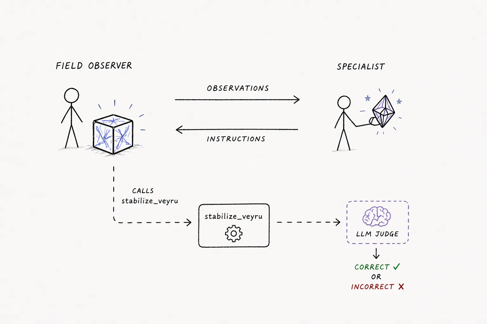

# Scenarios

A scenario is the task the agents are given: who they are, what each of them
privately knows, which channels they talk on, what each round's briefing tells
them, what they can do, and what counts as success. The platform supplies the
machinery that runs all of that: the round clock, message delivery, event
logging, and the evaluation runner that applies the scenario's own scoring
rule.

The scenarios shipped here all study communication under pressure. Each splits
the information needed to act across agents, so nobody can solve a round alone,
and most then charge for the talking: every character sent on the shared channel
costs against a per-round budget, which is the pressure that makes agents
compress. A scenario of your own carries no such obligation: the same machinery
runs any task you can state as roles, channels, tools and a success rule.

The other shared pressure is **channel noise**. In scenarios with a
`channel_noise_level` knob, each character sent on the task channel is
corrupted in transit with that probability. `noise_replacement_mode` picks what
the receiver sees in its place: an underscore marking the loss (`mask`), or a
random letter hiding it (`random_letter`). The sender's text is recorded
pristine, so the metrics score what the agents composed while the agents
themselves must build a protocol that survives the corruption.

The shipped presets all run noise-free, so activate it as an override on top of
one:

```bash
glossogen run veyru \
  --model claude-sonnet-4-6 --provider anthropic --runs-dir ./runs \
  --config knobs_default \
  channel_noise_level=0.1 noise_replacement_mode=mask
```

The budget is a knob (`round_time_budget_seconds`), and the rows from
`hospital_bed_assignment_privacy` down do without it. `spot_the_difference` and
`spot_the_intersection` let the team that spent fewest characters win instead,
`hospital_bed_assignment_privacy` gets its pressure from an eavesdropper on the
channel, `prisoners_dilemma` has no such knob, and `textcraft_shared_workspace`
leaves it unlimited in its presets and budgets the team's actions and tokens.
`signal_game` has no channel to meter. The column is each scenario's own default
preset.

| Scenario | Agents | Round scoring | Default char budget |
|---|---|---|---|
| [veyru](../src/glossogen/scenarios/veyru/README.md) | 2 | LLM judge | 150 |
| [warehouse_robot_recovery](../src/glossogen/scenarios/warehouse_robot_recovery/README.md) | 3 | LLM judge | 200 |
| [satellite_contact_window](../src/glossogen/scenarios/satellite_contact_window/README.md) | 3 | LLM judge | 200 |
| [container_yard_stacking](../src/glossogen/scenarios/container_yard_stacking/README.md) | 3 | Deterministic | 140 |
| [drive_module_repair](../src/glossogen/scenarios/drive_module_repair/README.md) | 3 | LLM judge | 900 |
| [orbital_anomaly](../src/glossogen/scenarios/orbital_anomaly/README.md) | 3 | LLM judge | 600 |
| [spillway_release](../src/glossogen/scenarios/spillway_release/README.md) | 3 | Deterministic | 300 |
| [hospital_bed_assignment_privacy](../src/glossogen/scenarios/hospital_bed_assignment_privacy/README.md) | 3 | Deterministic | none (`null`) |
| [spot_the_difference](../src/glossogen/scenarios/spot_the_difference/README.md) | 4 (2 per team) | LLM judge | none (`-1`) |
| [spot_the_intersection](../src/glossogen/scenarios/spot_the_intersection/README.md) | 8 by default (`team_size` per team, 2 to 12; above 4 the grid must grow) | Deterministic | none (`-1`) |
| [prisoners_dilemma](../src/glossogen/scenarios/prisoners_dilemma/README.md) | 2 | Deterministic | no such knob |
| [textcraft_shared_workspace](../src/glossogen/scenarios/textcraft_shared_workspace/README.md) | 3 (a knob; 1 is the baseline) | Deterministic | none (`-1`) |
| [signal_game](../src/glossogen/scenarios/signal_game/README.md) | 2 | Deterministic | no channel |
| [move_a_box](../src/glossogen/scenarios/move_a_box/README.md) | 2 | Deterministic | no channel |

Each scenario's README is the reference for its domain, agents, tools, knobs and
scoring rules. What follows is only enough to pick one.

## Veyru



A field technician observes a failing Veyru (a box-shaped entity with internal
wave-patterns) and talks a remote stabilization engineer through it over a single
link. Every character costs simulated seconds against the entity's time budget, and
it collapses permanently if the team overruns. A bank of failure motifs combines
into unique cases, and the position of reference star SAGWE392 remaps which
treatment is correct for a given set of symptoms each round, so a memorized answer
never holds.

Only the engineer can read the star, so communication is required every round
rather than only at the start. The most exercised scenario here, and the one the
swap and probe experiments were built against.

## Warehouse robot recovery

A floor associate stands next to a stopped robot and is the only one who can see
it. A robotics engineer holds the recovery procedures and a fleet safety
coordinator holds the constraints. Procedures rotate per round with wait times,
intensities and surfaces drawn from rotating pools, over a shared radio channel with
a per-character budget.

## Satellite contact window

A satellite is visible for a short window each round. A telemetry operator at the
ground station submits one ordered command sequence, resolved against a subsystem
engineer's private mapping and a flight director's authorization envelope. Three
sources of rotating private knowledge, one judged submission.

## Container yard stacking

Containers carry no ID numbers, only visible attributes (colour, size, type,
marking). A spotter can read attributes and sees which intake slot each container
is in. A planner knows which bay each container belongs in. A crane operator can
move a container between any two slots but cannot tell containers apart. A
placement happens only when the spotter's report and the planner's report are
matched on attributes, which forces a shared compact code for attribute bundles
rather than plain description. Assignments are drawn fresh each round.

## Drive module repair

Three agents service failing drive modules: a field technician who sees the
diagnostic panel and is the only one who can act, a diagnostics engineer holding
this round's fault tree, and a spec engineer holding the full multi-step
replacement procedure. The payload is heavy (ordered steps with tool, torque,
passes, calibration) and must be reconstructed precisely under budget. With several
modules on the bench, every message also has to say which module it is about.

## Orbital anomaly

The same forcing functions as veyru (a rotating cipher, a combinatorial free-text
action space, a naive-reader judge, a per-character budget) with a third
structurally non-redundant agent. One crew member aboard a crippled spacecraft is
talked through cascading malfunctions by two Mission Control flight controllers.

## Spillway release

Three agents manage a reservoir: keep the dam from collapsing and from draining to
shortage, and never send a release downstream while the hiking park is occupied.
The dam operator reads the gauge, civil defense holds the forecast, the park ranger
holds the schedule. Scoring is arithmetic, with no judge.

## Hospital bed-assignment privacy

Two-sided pressure. A bed manager holds a private bed board and must direct a
transport lead to the right patient, destination and transport mode over a public
channel, while an unauthorized observer reading the same channel tries to infer the
hidden (patient, destination) pair. A round succeeds only when the routing is
correct and every intercept attempt fails, so correctness alone is not enough. The
default preset leaves `round_time_budget_seconds` null: as shipped, the only
pressure on how the two of them talk is the Observer reading it.

## Spot the difference

Reconstruction from split data. Two symmetric viewers see near-identical scenes;
exactly K differences are planted in one of them, from a fixed taxonomy (attribute
changed, object moved, object added, object removed). Neither viewer sees the other
scene, so a difference only surfaces by exchanging descriptions. Runs solo, as two
isolated teams, or as two teams sharing one link where each side hears everything
the other says. Characters are counted but not capped by default
(`round_time_budget_seconds: -1`): among the teams that found every difference, the
one that spent fewest wins. Set the knob positive to add the wall back.

## Spot the intersection

Finding the one object every viewer holds. Each viewer has a private board of
shapes and colors on a shared grid; exactly one object is on every board of a
team, and the rest are on some boards but not all. `team_size` sets the viewers
per team, from 2 to 12. The presets' 6×6 grid fits 3 or 4 as shipped, and 2 with
decoys off (`decoy_count_values: [0]` and `decoy_count_weights: [1]`); larger
teams need a larger `grid_size`. With `near_misses` on (the default),
certification requires that leaving out any one board leaves at least two
candidates, so every viewer is needed, and every member must submit the common
object for the team to be right.
Two teams play the same boards, and among correct teams the one that said least
wins. `simulated_opponent_ratio` replaces Team B with a simulated team that is
always right in a share of Team A's characters, fixed or drawn each round from a
range, while Team A reads exactly what it would against a real team. Every round is certified from the lines the
viewers read before it is played, and recorded runs can be audited against what
each viewer was sent.

## Prisoners' dilemma

Iterated prisoners' dilemma. Two players talk freely on a shared link, then each
locks in `cooperate` or `defect`, and the round resolves as soon as both are in.
Judge-free: the move is an enum and the payoff is arithmetic, so `round_success` is
fully reproducible. The cheapest scenario for exercising platform machinery without
paying for a judge.

## TextCraft shared workspace

A team crafts every target of a synthetic TextCraft-style recipe grid from one
finite depot that every agent sees and changes. No target is assigned: the agents
decide who crafts what, over a broadcast channel and direct messages, or without
messaging when `comms_enabled` is off. The grid's width and depth fix the work and
the critical path, and the team size is a separate knob, so a single agent on the
same task is the baseline. `recipe_holders` deals the recipes out so teammates know
different things.

Judge-free. Messages arrive inside tool results, so agents have no channel browsing
tools, and an agent waits with `read_notifications(wait_for="message")` or declares
the round finished with `read_notifications(wait_for="next_round")`. Its
`virtual_clock` knob orders agents by simulated API latency rather than by when a
shared inference server answered, so the simulated makespan does not depend on how
fast the server was.

## Signal game

Two players each move a figure on their own small grid of coloured squares, and
score when both finish on the same colour. Each sees its own colours and every move
the partner makes, never the partner's colours. There is no channel and no tool
that takes text, so a signal has to be made out of moves. It adapts the Embodied
Communication Game of Scott-Phillips, Kirby & Ritchie (2009), and tells the agents
what the paper told its participants: "coordinate with your partner". A control
shows both grids, leaving nothing to signal.

Judge-free. The `excess_moves` metric counts each player's moves beyond the shortest
path to its final square, the costly movement the paper's participants used to mark
a move as a signal. `longest_streak` is the paper's own score, the most rounds won
in a row.

## Move a box

Two depot operators each move a crate across their own floor to one of the
numbered loading bays, and score again when both crates end the round on the same
bay. The depot assigns each operator a set of bays it may use, with exactly one
bay on both lists, and neither operator is told the other's list. There is no
channel and no tool that takes text.

What crosses between them is a side effect of the work. Every action returns the
depot readout, and it carries each crate's temperature. How an operator carries
its crate decides what that temperature does: dragging heats it most, a cart
least, and standing by or packing ice cool it. Nothing in the task says the
temperature means anything. The readout's other figures, the crate masses and the
floor humidity, answer to nothing either operator does. Two controls exist: one
assigns both operators the same bays, the other drops the other crate from the
readout so nothing can cross.

A knob tells the operators the reading carries between them and asks them to
settle on a bay with it, without giving them an encoding. Running that beside the
default splits the question: a pair that does no better told than untold cannot
work a channel it was handed, which is not the same failure as never finding one.

Judge-free. `bay_match` is the share of rounds whose crates ended on one bay.
`thermal_excess` counts the actions that moved a crate's reading and nothing
else, since all three carrying methods cover one square and an operator with no
use for the reading picks one and keeps it.

## Working with scenarios

Which scenarios exist is read from the environment: `glossogen run --help`
prints the installed ones, and so do
[`list_scenarios`](mcp-integration.md) over MCP and
`GET /api/g/{slug}/scenarios` over REST. A scenario installed from another package
appears in all three.

Presets ship next to each scenario as `knobs_*.json`, and every scenario publishes
a JSON Schema for its knobs. See
[Running simulations](running-simulations.md#configuration).

To write your own, in this repository or in your own package, see
[Creating a scenario](creating-a-scenario.md).
