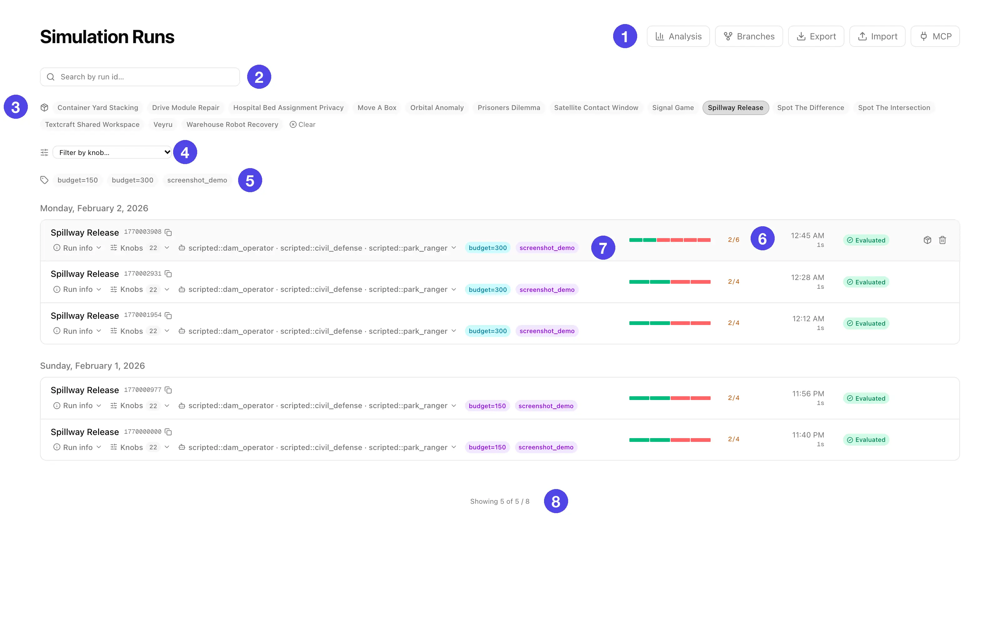
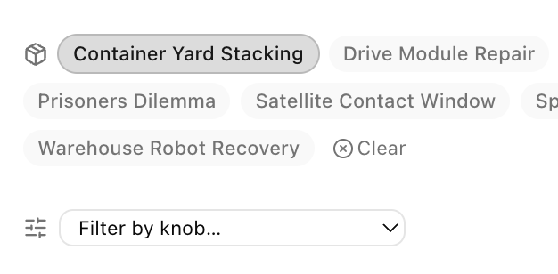
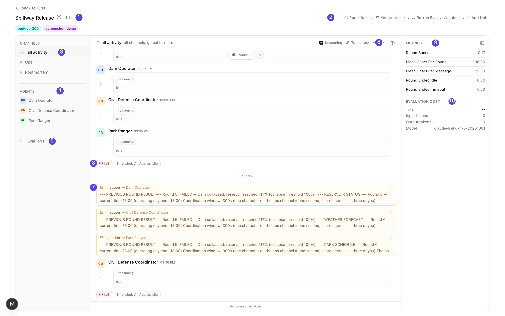

# Web UI

A FastAPI backend and a Next.js frontend for browsing runs. One command starts
both:

```bash
glossogen serve --runs-dir ./runs --port 8000 --ui-port 3000
```

Open <http://localhost:3000> once it is up. `--ui-port` starts the UI from the
published frontend container, so it needs Docker. Omit it to run the backend
alone. The server runs in your own environment, so scenarios and metrics
installed from other packages appear in the UI.

The flag runs the latest published UI, wires `API_URL` to the server it just
started, and adds the UI's origin to CORS. `--ui-image` pins an older UI, which
an older server needs, since a current UI calls endpoints it may not serve. It
takes the full image reference, not just the tag:

```bash
glossogen serve --runs-dir ./runs --port 8000 --ui-port 3000 \
  --ui-image ghcr.io/agencyenterprise/glossogen-frontend:v0.17.16
```

Image tags are the release tags, `v` included.

From a checkout, run the two as dev processes instead, one terminal each:

```bash
make dev            # terminal 1: FastAPI backend on port 8000 (reads ./runs/)
make dev-frontend   # terminal 2: Next.js dev server on port 3000
```

The dev frontend reads `frontend/.env.local`, copied from
`frontend/.env.local.example`. Its one required variable is `API_URL`, the
backend's URL. It is read at request time and forwarded to the browser by the
root layout, never compiled into the bundle, so changing it takes a restart.

Pointing the checkout UI at a server on another port makes two settings yours
to keep in step: `API_URL`, and the backend's `ALLOWED_ORIGINS`, which
defaults to `http://localhost:3000`. A UI served from an unlisted origin
renders pages whose API calls are refused by CORS, which shows up as an empty
run list rather than as an error.

## The runs page



| # | What it is |
|---|---|
| 1 | Navigation: Analysis (cross-run charts), Branches (lineage), Export and Import (move runs out as CSV or archives, or in from another deployment), and MCP connection instructions |
| 2 | Search by run id substring |
| 3 | Scenario filter, one chip per loaded scenario, shown when more than one is loaded. Selecting exactly one reveals the knob filter bar, item 4 |
| 4 | The knob filter bar, covered below |
| 5 | Label filter, AND-matched: a run must carry every selected label. `eval:*` and `src=*` labels get no chip |
| 6 | A run row: when it started, how long it ran, what it cost when that is above zero, and the rounds it played, as a pass/fail bar per team when the scenario judges its rounds. A status shows only when the run did not complete: starting, in progress, error or killed. Hovering the row offers the run's bundle for download and a delete button, which asks before it moves the run to the runs directory's `_trash/`. An evaluated run carries an **Evaluated** badge whose hover lists its scores. A live run also has a stop button, which asks first too |
| 7 | The run's id with a copy button, then the **Run info**, **Knobs** (the full recorded config) and models dropdowns, and the run's labels. Lineage badges sit beside the id: fork, replace-agent, cross-run, fork-at-round, and the intern and two-team modes. A run with a note carries a **Note** button that opens it |
| 8 | The result count: how many runs are loaded, out of how many match. With a filter on, a third number gives the baseline: the runs the other filters leave before the knob conditions, or the whole group when no knob condition is set |

### Filtering by knob



Select a single scenario and a filter bar appears offering that scenario's
knobs. Pick a knob, a comparison and a value, and press Add. Conditions
accumulate as chips and every one has to hold. Each row then shows the value it
recorded for every knob a condition names.

The comparisons on offer follow the knob's type:

| Knob type | Comparisons | Value |
|---|---|---|
| Integer or number | `>= <= > < = !=` | a number |
| Boolean | `=` | true or false |
| Enum | `=` `!=` | one of the knob's own values |
| String | `=` `!=` | typed text |

A knob that can be left unset also gets a "not set" box, which takes `=` or `!=`.

The knobs come from the scenario's own schema, so a scenario loaded from
outside glossogen is filterable with no change to the platform.

The same conditions travel to the CSV and raw exports, to `glossogen export
--knob` and `glossogen analyze --knob`, and to the export endpoints as the
selection's `knob` array. See
[Filtering by knob](exporting-runs.md#filtering-by-knob) for the grammar.

**Analysis** opens the cross-run surface: pick a cohort, group and filter it, chart
metrics from the evaluation reports, and save the result as a dashboard the rest of
the group can open. See [analysis and dashboards](analysis.md).

## Inside a run



| # | What it is |
|---|---|
| 1 | The run: scenario, a button opening the scenario's description, a copyable id, lineage badges for a derived run, and its labels |
| 2 | Run info and actions: the recorded knobs, running or re-running evaluation (offered once the run has ended, and hidden when the server disables evaluations), editing labels, attaching a note |
| 3 | Channel tabs: every channel's messages interleaved in send order, or one channel at a time |
| 4 | Agent tabs: the run as one agent saw it. A seat swapped mid-run gets one tab per occupant |
| 5 | The evaluation log, when an evaluation has run |
| 6 | Timeline controls: show or hide reasoning, filter tool calls, export the run as a PDF or a bundle |
| 7 | An injection: the briefing the scenario handed one agent at the start of the round |
| 8 | The round's verdict and why it ended (agents idle, timeout, or the scenario's own trigger) |
| 9 | The evaluation report's headline scores |
| 10 | What the evaluation itself cost, and the judge model it ran under |

## Live streaming

Every `glossogen run` starts an embedded streaming server on an ephemeral port and
writes a `stream.json` discovery file into the run directory. When the web server
sees that file it proxies the simulation's SSE stream to connected browsers,
including token-by-token deltas, so text appears as agents generate it. When the
simulation ends, `stream.json` is deleted and the server falls back to tailing the
JSONL.

## Run labels

Labels are short tags on a run, for filtering and grouping. Add or edit them
with the run page's **Labels** control, and filter the runs list by them: a run
must carry every selected label. There is no way to set them at launch, so
label a run once it appears in the list.

On disk a run's labels are `labels.json` in its run directory, a JSON list of
strings, so scripts can read and write them too:

| Way | How | Note |
|---|---|---|
| The API | `PUT /api/g/{group_slug}/runs/{scenario}/{run_dir_name}/labels` with body `{"labels": [...]}` | Replaces the whole list, so read the current labels first when adding to them |
| A direct file write | Write `labels.json` as soon as the run directory exists | What orchestrator scripts do: faster, and needs no backend running |

On a server backed by a database, label filtering and the filter dropdown read
a mirror of that file kept on the run's index row. Rows never mirrored are
backfilled at server startup. After that a direct file write reaches the mirror
only when the server next reads the file (the run appearing on a listed page,
its detail opening, or an export the run matches). Until then a label-filtered
view can miss the run. Labels applied through the API are visible immediately.

`glossogen evaluate` no longer writes `labels.json`, so `eval:*` labels exist
only on runs evaluated before that changed.

### Describing a label

A group keeps a glossary of what each label means, keyed on the exact label
string, so a description covers every run carrying that label. The UI shows it
when you hover a label chip. Record one when you create a cohort label, so the
next reader does not have to reverse-engineer what the cohort was for.

| From | Set | Read |
|---|---|---|
| The CLI, on the local group | `glossogen describe-label <label> --description "..."` | `glossogen list-label-descriptions` |
| The API | `PUT /api/g/{group_slug}/labels/descriptions` with body `{"label": ..., "description": ...}` | `GET` on the same path |

The label travels in the body or a query parameter, never the path, because
labels such as `src=veyru/123` carry slashes. `describe-label --delete` removes
a description. [`sync-metadata-to-prod`](mcp-integration.md#from-the-cli)
copies the local glossary to a remote.

Authentication modes are covered under
[Deployment](deployment.md#authentication), and the identity-provider contract
in [Creating an identity provider](creating-an-identity-provider.md).
